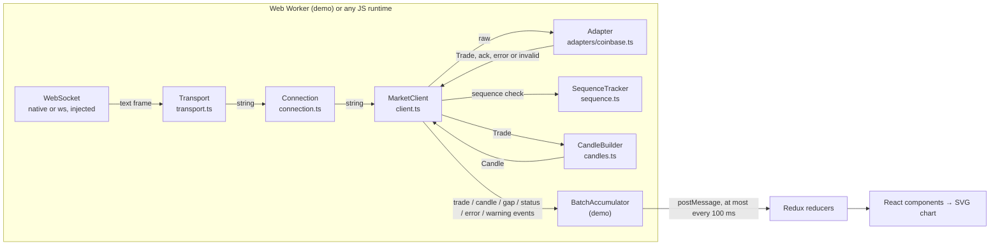

# Architecture

This document explains how tickforge is put together and why. It is written
for a reviewer who wants to judge the design decisions, so it states the
trade-offs and limitations next to each choice. Source paths are relative to
the repository root.

## Scope

tickforge streams **trades** from a crypto exchange's public WebSocket feed,
normalizes them into one typed shape, and derives **1-minute candles** from
them. It runs unchanged in Node 22+, browsers and web workers, with no runtime
dependencies.

Out of scope, deliberately: order books, REST endpoints, authenticated
channels, persistence, and historical backfill. Each would add a dependency or
a large surface area; none is needed to demonstrate a resilient streaming
client.

## Data flow



Each stage only knows the stage next to it. The transport moves bytes, the
connection manages one socket's lifecycle, the adapter knows one exchange's
wire format, and the client owns subscriptions and events. The demo adds a
worker boundary and a batching step on top of the public API; the SDK knows
nothing about either.

## SDK

### Transport abstraction (`packages/sdk/src/transport.ts`)

The SDK talks to a minimal `WebSocketLike` interface: `send`, `close`,
`readyState` and `addEventListener` for four events. The browser `WebSocket`,
Node 22's global `WebSocket` and the `ws` package all satisfy it, which a
type-level test enforces.

- **Default:** `globalThis.WebSocket`. Node 22+ has one, so the SDK has no
  dependency on `ws`.
- **Injection:** `new MarketClient({ WebSocket })` accepts any compatible
  class. Users pass `ws` when they need proxies or custom headers; tests pass
  a scripted fake; the demo passes an instrumented subclass (see below).
- **Detach on close:** once the client calls `close()` on a transport, that
  transport never invokes a handler again. A socket being torn down therefore
  cannot trigger a reconnect, a status change or an event. This removes a
  whole class of "zombie socket" bugs in which an old socket's late `close`
  event disturbs its replacement.

Trade-off: listener payloads are typed `unknown` and narrowed internally,
because the DOM and `ws` event types differ in ways a single typed signature
cannot satisfy.

### Connection manager vs. adapters

`Connection` (`connection.ts`) owns one logical connection: opening, stale
detection, reconnecting and shutting down. It moves strings and knows nothing
about exchanges.

An adapter (`adapters/coinbase.ts`) is a set of pure functions: build a
subscribe or unsubscribe frame, and parse one raw message into a typed
`AdapterEvent`. It holds no state and does no I/O.

`MarketClient` (`client.ts`) sits between them and owns everything stateful
about the data: which symbols are wanted, which requests are pending, and the
candle builder.

This split makes the reconnect logic testable without any exchange, and makes
an adapter testable as input → output tables. Adding an exchange means writing
an adapter, not touching reconnect code.

### Connection states and `idle`

```text
idle ──subscribe()──► connecting ──► open ──► reconnecting ──► connecting ──► …
 ▲                                    │
 └──── unsubscribed from everything ──┘

any state ──close()──► closed (terminal)
```

The client connects lazily on the first `subscribe()` and returns to `idle`
when the last symbol is unsubscribed. In `idle` there is no socket and no
timer.

`idle` exists because the alternative is a loop. Coinbase closes connections
that have no subscriptions, and the stale detector would also fire on a silent
socket; both lead to reconnecting a socket nobody needs, forever. Making "no
subscriptions" a real state removes the loop and means an unused client costs
nothing.

### Reconnect: backoff with full jitter

The delay before reconnect attempt _n_ is

```text
random(0, min(maxDelayMs, initialDelayMs × 2^(n−1)))      defaults: 500 ms, 30 s
```

This is "full jitter". Plain exponential backoff makes every client that
lost its connection in the same incident retry at the same moments, so the
server sees synchronized waves of reconnects. Spreading each client's retry
uniformly over the whole window removes the waves. The exponent is clamped so
large attempt numbers cannot overflow.

**The attempt counter resets on the first message after a reconnect, not when
the socket opens.** A server that accepts the TCP/TLS handshake and then
immediately drops the connection would otherwise reset the counter every time,
and the client would retry at the minimum delay indefinitely. Receiving data
is the evidence that the connection works.

### Stale detection

A timer is re-armed on every incoming message (default 10 s). If it fires,
the client reports a `TRANSPORT_ERROR` and reconnects. A dead TCP connection
can stay "open" for minutes without any error, so silence is the only
reliable signal. To keep a healthy but quiet market from looking dead, the
Coinbase adapter subscribes to the `heartbeat` channel, which sends a message
for each product every second.

### Subscriptions and acknowledgements

Subscribe and unsubscribe calls return promises that settle when the exchange
confirms them, or reject with `REQUEST_TIMEOUT` (default 10 s).

**How a confirmation is matched to a request.** Coinbase acknowledges
every subscribe or unsubscribe frame with a `subscriptions` message that
contains the **full** current subscription list. It carries no request id.
Frames are acknowledged in order on a connection, so pending frames are kept
in a FIFO queue and each ack completes the oldest one.

**What we found against the live feed.** For an invalid product, Coinbase
sends one `error` message _per subscribed channel_ (two, for `matches` and
`heartbeat`) and then still sends a `subscriptions` snapshot. This is not
documented. A first design that treated each `error` as the response to a
request settled the wrong requests whenever two were in flight: the second
`error` resolved or rejected the next request.

The final design does not count messages. An `error` is attached to the
oldest pending frame and judged later. When that frame's snapshot arrives,
success is decided **per symbol**: a symbol is confirmed if and only if it
appears in the snapshot. This is correct regardless of how many errors
preceded the ack, and it handles partial success (a mixed request where some
products are valid). The mock server in the tests reproduces the live
behaviour, and a regression test covers the pipelined case.

**All-or-nothing.** If any symbol in a `subscribe()` call is rejected, the
promise rejects and the call's other symbols are rolled back, including on
the exchange: the client sends an unsubscribe for the part the exchange
accepted. The alternative, resolving with a partial result, would make every
caller inspect the result to know what they actually have.

**Rollback ownership.** A rollback must never remove a symbol that someone
else is relying on. The client keeps two sets: `desired` (everything wanted,
including pending) and `active` (symbols a `subscribe()` call has resolved
for). A failed call releases a symbol only if it is not `active` and no other
unsettled subscribe call still claims it. A second call for a symbol that is
still pending does not resolve immediately; it sends its own frame and waits
for its own ack (the exchange treats a duplicate subscribe as a no-op).

**Reconnects.** After any reconnect, one frame re-subscribes every desired
symbol, and subscribe calls that were waiting for an ack ride along with it.
If a symbol disappears from the snapshot during re-subscription (for example
it was delisted while disconnected), it is removed and reported once as an
`EXCHANGE_ERROR` with `details.symbols`.

### Parsing and validation

Everything from the network is untrusted. The adapter parses inside a guard
and validates every field it uses: prices and sizes must be finite numbers
(Coinbase sends them as strings), timestamps must be valid ISO dates, and
enumerations must have known values. A message that fails is dropped and
surfaced as a `PARSE_ERROR` event with a truncated copy in `details.raw`. The
parser never throws.

Two Coinbase-specific normalizations:

- **Side.** A Coinbase `match` reports the maker's side. tickforge reports
  the taker's (aggressor's) side, which is what most analytics expect, so the
  value is flipped.
- **`last_match`.** Coinbase replays the most recent trade on every new
  subscription. It is never emitted as a trade, so a reconnect does not
  duplicate one, but its trade id is used as a position marker for gap
  detection (next section).

### Data integrity: gaps, duplicates and reordering

Coinbase's documentation says messages "can be dropped" from the `matches`
channel, and every reconnect loses whatever traded while the client was
away. A market data client has to know when that happened; silently
producing a smaller volume or a wrong high/low is the worst outcome.

**Which number to trust (verified on the live feed).** Each `match` carries
two candidates. Recording 60 seconds of BTC-USD and ETH-USD showed:

| Field                     | Behaviour between consecutive matches                | Usable?                                                                                                           |
| ------------------------- | ---------------------------------------------------- | ----------------------------------------------------------------------------------------------------------------- |
| `sequence`                | jumps by 2 to 2,667                                  | No: it numbers the whole order-book stream, of which trades are a small subset, so it "gaps" constantly by design |
| `trade_id`                | always exactly +1 per product (2,853 of 2,853 steps) | Yes                                                                                                               |
| heartbeat `last_trade_id` | agreed with the trades seen so far 54 of 58 times    | Not alone: it races with match delivery and would cause false alarms                                              |

Coinbase also sends `last_match` once per **newly** subscribed product
(verified: subscribing to ETH did not resend BTC's), and its `trade_id` is
the trade immediately before the first match that follows. After a 15-second
disconnect, comparing it with the last trade seen before the drop gave the
exact number of trades missed (262 for BTC-USD).

**Design.** The adapter reports each trade's `trade_id` as a `sequence`, and
`last_match` as a `position`. A small `SequenceTracker` (`sequence.ts`) keeps
the last accepted sequence and time per symbol and classifies each event:

| Event                                   | Verdict      | What the client does                                  |
| --------------------------------------- | ------------ | ----------------------------------------------------- |
| trade, `n = last + 1`                   | next         | emit                                                  |
| trade, `n > last + 1`                   | gap          | emit a `gap` event, flag candles, then emit the trade |
| trade, `n = last`                       | duplicate    | drop, count in `stats.duplicateTrades`                |
| trade, `n < last`                       | out of order | drop, count in `stats.outOfOrderTrades`               |
| position `p > last` (after a reconnect) | gap          | trades `last + 1 … p` were missed                     |
| position `p ≤ last`                     | current      | nothing                                               |
| first trade or position for a symbol    | first        | baseline                                              |

Duplicates and late trades are dropped rather than emitted because emitting
them would double-count volume or apply a stale price as a candle's close.
The tracker never moves backwards. Unsubscribing a symbol forgets its
position, so a deliberate unsubscribe and resubscribe is not reported as a
gap. Trades without a usable id (not a safe integer) skip detection rather
than risk false gaps.

The `gap` event carries `symbol`, `reason` (`stream` or `reconnect`),
`expected`, `received`, `missed` (= `received − expected`, exact for
Coinbase because trade ids are contiguous) and the time range `from`/`to`.
`client.stats` keeps running totals.

**Candles affected by a gap.** Every candle whose minute overlaps
`[from, to]` gets `incomplete: true`:

- a candle still open is flagged in place;
- a candle that already closed (the minute-end timer usually closes one
  during a reconnect) is emitted once more, with identical values and
  `incomplete: true`;
- candles opened later for minutes up to `to` start out flagged.

Only the most recently closed candle can be affected, because every earlier
one ends before the last trade seen, so the builder keeps just that one. The
flag only goes from `false` to `true`. Minutes inside the range that have no
candle are unknown, not empty; consumers can tell them apart with the event's
time range.

**Not done: backfilling missed trades.** Detection says what is missing; it
does not recover it. Coinbase's REST API can return trades by id
(`GET /products/{id}/trades` with an `after` cursor), so missed ranges are
recoverable in principle. It is not built because doing it reliably is a
project of its own: live trades must be buffered while the backfill runs,
then merged and de-duplicated by id; a long outage needs many pages under
public rate limits; and candles that were closed and published need to be
rebuilt and re-published. The `gap` event provides exactly the inputs (symbol
and id range) such a backfill would need.

### Events

`MarketClient` extends a small typed emitter rather than Node's
`EventEmitter`, for three reasons: it must run in browsers; Node's emitter
throws when `error` has no listener, which would let a malformed exchange
message crash the host process; and a listener that throws must not stop the
others. A throwing listener's exception is re-thrown on a microtask, so it is
still reported as uncaught rather than silently swallowed.

### Slow consumers: `trades()` and dropped trades

`client.trades(symbol)` returns an async iterator backed by a bounded queue
(default 1000 trades). When the queue is full, the **oldest** trade is
dropped. For live market data a fresh value is worth more than a complete but
stale history, and an unbounded queue would grow without limit behind a slow
consumer.

Drops are observable rather than silent:

- `iterator.dropped` counts them.
- A `warning` event (`TRADES_DROPPED`) is emitted once per _overflow
  episode_, meaning the first drop after the consumer last emptied the queue.
  Emitting one warning per dropped trade would add work to a consumer that is
  already too slow.

The iterator is a view over the `trade` event and does not subscribe for
you. Making it subscribe would require hidden reference counting to decide
when to unsubscribe after `break`. Code that must not lose trades should use
the `trade` event directly and apply its own backpressure policy.

### Candles

Coinbase's feed has no candle channel, so candles are derived from trades by
`CandleAggregator` (`candles.ts`), a pure, timer-free class.

- **Updates.** Every trade that changes a candle emits it with
  `closed: false`.
- **Close timing.** The final version is emitted once with `closed: true`, at
  whichever comes first: the first trade of a later minute, or a timer at the
  end of the minute plus a 2-second grace period. Without the timer, an
  illiquid symbol's candle could stay open for many minutes. The grace period
  absorbs network latency and small differences between the local clock and
  exchange timestamps.
- **Empty minutes produce no candle.** There is no price information for a
  minute without trades; a flat candle would be invented data. Consumers that
  need a continuous series can fill gaps explicitly.
- **Closed candles are final.** A trade for a minute that is already closed
  still emits a `trade` event but changes no candle's values. The one
  exception to "emitted once" is the `incomplete` flag after a gap (above).

The client depends on a `CandleBuilder` interface, not on the class, and
accepts an alternative implementation through the `candleBuilder` option. This
is the seam for an alternative engine, such as the Rust/WebAssembly builder in
progress, without the SDK importing it. The option costs 13 bytes gzipped.

## Demo (`apps/demo`)

### SDK in a Web Worker, batched to 100 ms

The `MarketClient` runs in a dedicated worker, so socket handling, JSON
parsing and validation never compete with rendering on the main thread.

The worker does not forward each event. It folds them into a
`BatchAccumulator`: the latest trade, each candle keyed by its minute (so many
updates to one candle collapse into one), the trades from the `for await`
loop, status changes and log lines. Every 100 ms it posts one message, or
nothing if nothing changed. This caps main-thread work at ten updates per
second however busy the market is. The cost is up to 100 ms of extra latency,
which is not perceptible on a chart.

### Store

Incoming batches go straight to pure reducers (`batchReceived`). Side effects
(sending commands to the worker, fetching history, applying the theme) live
in RTK listener middleware, and their dependencies are injected, so the store
is tested with fakes and no worker or network.

Candle history for the last hour comes from Coinbase's public REST API, so
the chart is not empty on load. It is demo scaffolding; the SDK itself is
real-time only. Live candles replace REST candles for the same minute, and the
first live minute is marked partial because streaming began part-way through
it. If the REST request fails or times out (8 s), the chart shows live candles
only, with a notice.

### Simulated disconnect through the injected WebSocket

The worker passes the SDK an instrumented `WebSocket` subclass through the
public `WebSocket` option. The subclass records subscription and
`last_match` frames for the connection log. "Simulate disconnect" closes
every open socket with an application close code and makes the constructor
throw for 3 seconds, as an unreachable network would. To the SDK this is
indistinguishable from a real outage, so the demo exercises the real path:
several failed attempts with jittered backoff, a reconnect, re-subscription,
and a `gap` event for the trades that happened meanwhile, with the affected
candles drawn hollow. If nothing traded during the outage, the log says so.
The SDK has no test-only hooks.

## Testing

- **Timing-sensitive logic** (backoff, stale detection, request timeouts,
  candle close timing) is tested with a scripted fake WebSocket and fake
  timers, so it runs at exact millisecond boundaries without real waiting.
  Tests assert that no timers remain after `close()`.
- **End-to-end tests** run the client against a real local WebSocket server
  that mimics Coinbase, including the undocumented error/snapshot behaviour
  and `last_match` on subscribe, once with the `ws` package and once with
  Node's native `WebSocket`. The server can withhold, repeat and reorder
  trades, so gaps (mid-stream and across a reconnect), duplicates and
  out-of-order delivery are tested over real sockets.
- **Type tests** fail the typecheck if public types regress.
- **Package tests** (publint, are-the-types-wrong) check the packed tarball
  under every TypeScript resolution mode.
- **Live tests** (`pnpm test:live`) run against the real Coinbase feed. They
  are opt-in and excluded from CI because they depend on the network and a
  third party.

Coverage is enforced at 90% for lines, branches, functions and statements.

## Known limitations

- **Missed trades are detected, not recovered.** Gaps are reported and the
  affected candles flagged, but missed trades are not backfilled (see above).
- **Gap detection relies on contiguous trade ids.** It is exact for Coinbase.
  An exchange without contiguous per-symbol ids would need a different
  signal.
- **The close timer uses the local clock.** If the local clock runs more than
  the 2-second grace period ahead of the exchange, a candle can close before
  its last trades arrive, and those trades are excluded from it.
- **Ack matching assumes in-order acknowledgements per connection.** This holds
  for Coinbase. Exchanges that reply with request ids (Binance) need the
  id-based matching that is planned with that adapter.
- **One exchange per client.** Users who need several exchanges create several
  clients.
- **`trades()` drops data by design** when the consumer is slower than the
  feed. The drop is counted and reported, not prevented.
